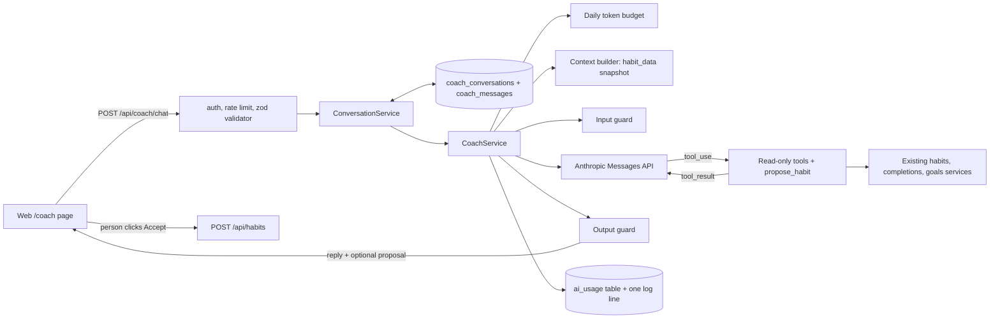

# AI coach

How to run, evaluate, change and switch off the AI coach. For how it was built and why, see [`ai-coach/PLAN.md`](./ai-coach/PLAN.md) and [`ai-coach/DEVELOPMENT_PLAN.md`](./ai-coach/DEVELOPMENT_PLAN.md). The prompt history is in [`ai-coach/PROMPT_NOTES.md`](./ai-coach/PROMPT_NOTES.md).

## What it does

The coach is a chat page at `/coach` in the web app. A signed-in person asks about their habits, streaks and goals in English or Ukrainian, and gets a short answer based on their real data. It can also suggest a new habit. The suggestion shows as a card, and the habit is created only if the person clicks Accept.

The coach only reads data. It cannot create, change or delete anything.

Each person has one ongoing conversation, saved on the server so it survives a reload. It is deleted when the person clicks New chat, when they delete their account, or after `AI_CONVERSATION_RETENTION_DAYS` (30) with no new message.

## Architecture



One request goes through these steps:

1. The route checks the session, the per-user rate limit and the request body (`validators/coach.validator.ts`). The body holds only the new message.
2. `ConversationService` (`apps/api/src/ai/conversation.service.ts`) deletes the person's conversation if it is past retention, then loads the last 20 saved messages.
3. `CoachService.reply` (`apps/api/src/ai/coach.service.ts`) stops with 503 if `AI_ENABLED=false`, then checks the daily token budget.
4. The context builder makes a small `<habit_data>` summary: active habits, streaks, 7-day counts and goal progress.
5. The service calls the model with the versioned system prompt, the four tools and the last 10 messages. The system prompt and tools are cached.
6. If the model asks for a tool, the service runs it with the `userId` from the session and sends the result back. It allows at most 5 rounds.
7. The output guard removes markup, caps the length, blocks replies that quote the prompt, and checks the habit proposal again.
8. The service writes one `ai_usage` row and one `ai_request` log line, for failed requests too.
9. On success, `ConversationService` saves the question and the reply together. A failed request saves nothing, so the browser keeps the question and can send it again.

`CoachService` itself stays stateless: it gets the history as an argument. Only plain text is saved, as the person saw it: the reply, the `truncated` flag and the habit proposal. Tool calls and tool results are not saved.

### Conversation storage and privacy

| What                        | How                                                                                                                                       |
| --------------------------- | ----------------------------------------------------------------------------------------------------------------------------------------- |
| One conversation per person | `coach_conversations` has a unique `userId`. Every query uses the `userId` from the session, so no route takes a conversation id.         |
| Delete on request           | New chat calls `DELETE /api/coach/conversation`. The conversation and its messages are deleted at once, not marked as deleted.            |
| Delete with the account     | Both tables cascade from `users`.                                                                                                         |
| Retention                   | A conversation with no new message for `AI_CONVERSATION_RETENTION_DAYS` is deleted on the person's next request, and by the purge script. |
| Never in logs or `ai_usage` | Message text is only in `coach_messages`. Log lines and usage rows keep metadata only.                                                    |
| Not rate limited            | Reading and deleting the conversation do not count against `AI_RATE_LIMIT_PER_MINUTE`, so a person can always delete it.                  |
| Cleared on sign-out         | The web app removes the cached conversation on sign-out, so the next person on the same browser does not see it.                          |

### Files

| Path                                                | What it is                                                         |
| --------------------------------------------------- | ------------------------------------------------------------------ |
| `apps/api/src/ai/client.ts`                         | The only place the Anthropic SDK is used. Timeout 30 s, 2 retries. |
| `apps/api/src/ai/coach.service.ts`                  | Kill switch, budget, tool loop, usage tracking, error mapping.     |
| `apps/api/src/ai/conversation.service.ts`           | Loads the saved history, saves each exchange, applies retention.   |
| `apps/api/src/ai/conversation.repository.ts`        | Reads and writes the conversation tables.                          |
| `apps/api/src/ai/prompts/coach.system.ts`           | System prompt and `COACH_PROMPT_VERSION`.                          |
| `apps/api/src/ai/prompts/coach.examples.ts`         | Few-shot examples.                                                 |
| `apps/api/src/ai/context.builder.ts`                | The `<habit_data>` snapshot.                                       |
| `apps/api/src/ai/tools/`                            | Tool definitions, input schemas and handlers.                      |
| `apps/api/src/ai/guardrails/`                       | Input guard, output guard, daily token budget.                     |
| `apps/api/src/ai/usage.repository.ts`               | Reads and writes the `ai_usage` table.                             |
| `apps/api/src/ai/pricing.ts`                        | Price per model, for cost estimates.                               |
| `apps/api/src/scripts/usage-report.ts`              | Usage and cost report.                                             |
| `apps/api/src/scripts/purge-conversations.ts`       | Deletes conversations past retention. Run it daily.                |
| `apps/api/evals/`                                   | Eval set, graders, runner, baseline.                               |
| `apps/web/app/coach/`, `apps/web/components/Coach*` | The chat page.                                                     |
| `.github/workflows/eval.yml`                        | Live evals, started by hand.                                       |

### Tools

| Tool                | What it does                                                                       |
| ------------------- | ---------------------------------------------------------------------------------- |
| `get_habits`        | Active habits with current and best streak and the last 7 days.                    |
| `get_habit_history` | Completions of one habit for up to 90 days.                                        |
| `get_goals`         | Goals with progress.                                                               |
| `propose_habit`     | Returns a suggested habit (name, color, reason) to show as a card. Writes nothing. |

### Configuration

All settings are environment variables, read once when the API starts. After you change one, restart the API.

| Variable                         | Default           | Meaning                                                                                           |
| -------------------------------- | ----------------- | ------------------------------------------------------------------------------------------------- |
| `ANTHROPIC_API_KEY`              | none              | Required unless `AI_ENABLED=false` or `NODE_ENV=test`. Server only.                               |
| `ANTHROPIC_MODEL`                | `claude-opus-5-5` | Model id. Add a new model to `pricing.ts` too, or cost shows as unknown.                          |
| `AI_MAX_OUTPUT_TOKENS`           | `2048`            | Output limit per model call. A reply that hits it is returned with `truncated: true`.             |
| `AI_RATE_LIMIT_PER_MINUTE`       | `10`              | Coach requests per person per minute. Kept in memory, so each API instance counts separately.     |
| `AI_DAILY_TOKEN_BUDGET`          | `100000`          | Tokens per person per UTC day: uncached input, cache writes and output. Cache reads do not count. |
| `AI_ENABLED`                     | `true`            | Kill switch. `false` makes the endpoint return 503 without calling the model.                     |
| `AI_CONVERSATION_RETENTION_DAYS` | `30`              | Days a conversation is kept after its last message.                                               |

## Threat model

Treat the model as an untrusted component. Each defence below is code, not an instruction to the model, and each has a test that fails if the defence is removed (`apps/api/src/ai/guardrails/threats.test.ts` and the tests next to each guard).

| Threat                    | Defence                                                                                                                                                                                                                                            |
| ------------------------- | -------------------------------------------------------------------------------------------------------------------------------------------------------------------------------------------------------------------------------------------------- |
| Leaked API key            | The key is only in the API's environment. It is not in the web bundle, the repo or the logs. `.env` is gitignored.                                                                                                                                 |
| Abuse and cost            | Per-user rate limit, per-user daily token budget from the `ai_usage` table, and a monthly spend limit in the Anthropic console.                                                                                                                    |
| Oversized input           | One message of at most 2,000 characters per request. Only the last 10 saved messages reach the model, and all but the newest are cut to 1,000 characters.                                                                                          |
| Forged conversation       | The client sends only the new message. The history comes from the database, so the client cannot send or rewrite earlier turns, a system prompt, tool calls or tool results.                                                                       |
| Prompt injection          | Habit and goal names come from people. They are placed in a `<habit_data>` block that the prompt marks as data. The input guard defuses the prompt's own tag names in messages. Tools are read-only, so a hijacked model still cannot change data. |
| Excessive agency          | The model cannot write. `propose_habit` returns a suggestion, and the person creates the habit through the normal `POST /api/habits`.                                                                                                              |
| Data leaks between people | Tools take `userId` from the session, never from the model. The services check ownership, so another person's habit id returns "not found".                                                                                                        |
| Unsafe output             | The reply is plain text, rendered as text. The output guard strips markup, caps the length and replaces a reply that quotes the system prompt. The proposal is checked with the same schema as creating a habit.                                   |
| Provider outage           | Only the coach depends on the provider. Errors become a short 429, 502 or 504 message. Provider messages are logged, never sent to the client.                                                                                                     |
| Personal data in logs     | Logs and `ai_usage` hold metadata only: user id, model, prompt version, tokens, latency, tool count and status. Never message text.                                                                                                                |
| Stored conversations      | Message text is kept only in `coach_messages`, only for the owner, and is deleted on request, with the account, or after the retention period. See [Conversation storage and privacy](#conversation-storage-and-privacy).                          |

## Evals

Unit tests check that the code works. Evals check that the answers are good. The eval set is 41 cases in `apps/api/evals/dataset/coach.cases.jsonl`, split into seven categories: accuracy, tool use, language, scope, injection, format and edge cases. The cases use fixed fixture users from `evals/fixtures/users.ts`, not the database, so the right streak or goal progress is known in advance.

Each reply is graded in two ways:

- **Code checks** (`graders/deterministic.ts`): the correct numbers, which tools were called, the language, the length, plain text, no internal ids, no prompt leak.
- **An LLM judge** (`graders/judge.ts`): for subjective cases only. It scores helpfulness, groundedness and tone from 1 to 5. A score below 3 fails the case.

Six cases are marked `"split": "holdout"`. Report them, but do not tune the prompt on them.

### Run the evals

From the repo root:

```bash
npm run eval -w @habit-tracker/api                       # live, needs ANTHROPIC_API_KEY
npm run eval -w @habit-tracker/api -- --repeat 2         # each case twice, for a steadier pass rate
npm run eval -w @habit-tracker/api -- --category injection
npm run eval -w @habit-tracker/api -- --case acc-current-streak --verbose
npm run eval -w @habit-tracker/api -- --no-judge         # cheaper, code checks only
npm run eval -w @habit-tracker/api -- --offline          # no key, tests the harness only
```

A full live run costs about $0.40 with the judge, and about twice that with `--repeat 2`. It does not need Postgres. The API config still requires `DATABASE_URL` and `JWT_SECRET`, so keep your normal `.env`.

`npm test` runs the offline part, so the normal CI checks the dataset, graders and runner without a key.

### In GitHub Actions

`.github/workflows/eval.yml` runs the live evals only when you start it. It never runs on a schedule or on pull requests, because each run costs money.

- It needs a repository secret named `ANTHROPIC_API_KEY`. On GitHub, open the repository → Settings → Secrets and variables → Actions → New repository secret. Name it `ANTHROPIC_API_KEY` and paste the key as the value. Use a separate key with its own spend limit, so you can tell CI cost apart and revoke it alone.
- To run it: Actions → AI coach evals → Run workflow. You can set the number of runs per case and turn the judge off.
- The job summary shows the result table. The reports are saved as the `eval-reports` artifact for 30 days.
- A failed run means the pass rate fell. Usually the cause is a model change on the provider side or a merged prompt change. Download the report and read the failing runs.

### Read the result

The runner prints one line per run (✓ or ✗), with the failed checks and the reply for each failure. Then it prints a table by category and split, the average tokens, latency and an estimated cost.

It saves `apps/api/evals/reports/latest.json` (gitignored) and a copy named after the time and prompt version. The main fields:

| Field                               | Meaning                                                                        |
| ----------------------------------- | ------------------------------------------------------------------------------ |
| `promptVersion`, `model`            | What was tested.                                                               |
| `passRate`, `byCategory`, `bySplit` | Share of runs where every check passed, overall and per group.                 |
| `judge.averages`                    | Average judge score per criterion.                                             |
| `averages`, `p95LatencyMs`          | Tokens, tool calls and latency per run.                                        |
| `estimatedCostUsd`                  | Cost of the run, from `pricing.ts`. `null` for a model missing from the table. |
| `harnessErrors`                     | Problems with the eval code itself, not with the answers.                      |
| `runs`                              | Every run with its reply, tool calls, checks and judge reasons.                |

Exit codes: `0` passed, `1` the pass rate is below 80% or more than 5 points under `evals/baseline.json`, `2` harness error. A category that drops is shown as a warning, not a failure, because one case already moves a small category by 20 points or more.

The judge can be wrong. When a run fails only on the judge, read its reason before you change anything.

### Add a case

When a real conversation goes wrong, turn it into a case. This is how the set grows.

1. Find a fixture user in `evals/fixtures/users.ts` that has the data you need, or add one.
2. Add one JSON line to `coach.cases.jsonl` with an `id`, `category`, `fixture`, `locale`, `messages` and `checks`. The schema and the list of check types are in `evals/cases.ts`.
3. Run only that case a few times: `--case <id> --repeat 3 --verbose`. Check that it fails for the bad behaviour and passes for a good reply.
4. Run `npm test -w @habit-tracker/api` so the offline tests validate the dataset.

Copy the shape of the conversation, never a real person's habit names or messages.

## Change the prompt safely

The prompt, the few-shot examples and the tool descriptions all change the coach's behaviour. Treat a change to any of them as a prompt change.

1. Run the full set first if `baseline.json` is old: `npm run eval -w @habit-tracker/api -- --repeat 2`.
2. Change one thing.
3. Increase `COACH_PROMPT_VERSION` in `coach.system.ts` (for example `coach-v6` to `coach-v7`). Usage rows and reports are grouped by this version, so a missed increase mixes two prompts in the numbers.
4. Run the full set with `--repeat 2`. Compare it with the baseline, by category and on the holdout cases. Read the replies that changed, not only the rate.
5. Keep the change or revert it. Write the result in `docs/ai-coach/PROMPT_NOTES.md`: the version, what changed, the pass rate, and what you saw in the replies.
6. If you keep it, run `npm run eval -w @habit-tracker/api -- --repeat 2 --save-baseline` and commit `baseline.json` with the prompt change.

For a change to the judge prompt, increase `JUDGE_PROMPT_VERSION` in `graders/judge.ts`. For a model change, set `ANTHROPIC_MODEL`, add its prices to `pricing.ts`, and follow the same steps. The runner warns when the baseline used a different model.

## Runbook

### Check usage and cost

```bash
npm run usage:report -w @habit-tracker/api           # last 30 days
npm run usage:report -w @habit-tracker/api -- 7      # last 7 days
```

It prints one row per prompt version and model: requests, errors, average and p95 latency, tool calls, tokens per request and estimated cost. It uses `DATABASE_URL`, so point that at the database you want to read.

For more detail, query the `ai_usage` table. The people closest to their daily budget today:

```sql
SELECT "userId",
       SUM("inputTokens" + "cacheWriteTokens" + "outputTokens") AS billable_tokens,
       COUNT(*) AS requests
FROM ai_usage
WHERE "createdAt" >= date_trunc('day', now() AT TIME ZONE 'UTC')
GROUP BY "userId"
ORDER BY billable_tokens DESC
LIMIT 10;
```

Errors in the last day, by the status code the person saw:

```sql
SELECT "errorStatus", COUNT(*)
FROM ai_usage
WHERE status = 'error' AND "createdAt" >= now() - interval '1 day'
GROUP BY "errorStatus";
```

Each request also writes one JSON log line that starts with `{"event":"ai_request"`. It has the same fields as the row plus `guardFlags`. A `prompt_leak` flag means the output guard replaced a reply that quoted the prompt.

What normal looks like with `coach-v6` on `claude-opus-5-5`: about 190 output tokens, 0 or 1 tool calls and 3 to 4 seconds per reply. The Anthropic console shows the real bill. The numbers here are estimates from `pricing.ts`, so check that file when prices change.

### Purge old conversations

```bash
npm run coach:purge -w @habit-tracker/api
```

It deletes every conversation with no new message for `AI_CONVERSATION_RETENTION_DAYS` and prints one JSON line with the count. Run it once a day from the host's scheduler. Without it, an idle conversation is still deleted on the person's next visit, but it stays in the database until then.

To delete one person's conversation by hand, for example after a support request:

```sql
DELETE FROM coach_conversations WHERE "userId" = '<user id>';
```

Messages go with it through the cascade.

### Turn the coach off

1. Set `AI_ENABLED=false` in the API's environment.
2. Restart the API.
3. Check: `POST /api/coach/chat` returns 503 "The AI coach is turned off", and the coach page shows the "turned off" message.

Nothing is sent to the provider and nothing is spent while it is off. The rest of the app works as normal. With `AI_ENABLED=false` the API starts without a key, so this is also the safe state while a key is revoked.

To turn it back on, set `AI_ENABLED=true`, make sure `ANTHROPIC_API_KEY` is set, and restart.

### Rotate the API key

Do this on a schedule, when someone with access leaves, and at once if the key may have leaked.

1. In the Anthropic console, create a new key in the same workspace. Check that the workspace spend limit is still set.
2. Put the new key in `ANTHROPIC_API_KEY` in the API's environment (the `.env` file locally, the host's secret settings in production) and restart the API.
3. Check: send one message on the coach page, and see a new `ai_usage` row with status `ok`.
4. If the CI key is the same key, update the `ANTHROPIC_API_KEY` repository secret too (Settings → Secrets and variables → Actions).
5. Delete the old key in the console.

If the key leaked, delete the old key first and set `AI_ENABLED=false` until the new one is in place. Then look at the console usage for calls you did not make.

### Provider outage or errors

People see these messages, and the rest of the app keeps working:

| Status | Message                                 | Cause                                                                                 |
| ------ | --------------------------------------- | ------------------------------------------------------------------------------------- |
| 429    | "The AI coach is busy right now…"       | The provider is rate limiting the key.                                                |
| 502    | "The AI coach is unavailable right now" | A provider error or a connection failure after 2 retries.                             |
| 502    | "…took too many steps to answer"        | The model asked for tools more than 5 times. A prompt or tool problem, not an outage. |
| 504    | "The AI coach took too long to answer"  | No answer within 30 seconds.                                                          |

Steps:

1. Check the Anthropic status page and the API logs. Provider errors are logged as `AI provider error: <status> <message>`.
2. Check the error rate with the `errorStatus` query above.
3. A `401` in the logs means the key is wrong or revoked: rotate it. A provider `429` means the account's rate limit or spend limit: check the console limits.
4. If the outage is long, set `AI_ENABLED=false`. People then get a clear "turned off" message instead of errors after a 30-second wait.
5. When the provider is back, turn the coach on again and check one message.

Switching to another model during an outage is possible with `ANTHROPIC_MODEL`, but run the evals on that model first. Its answers may be worse.

### Costs are too high

1. Run the usage report and the daily budget query to find out whether it is one person or everyone.
2. For one person, the daily budget already stops them at the end of the day. To stop sooner, lower `AI_DAILY_TOKEN_BUDGET` or `AI_RATE_LIMIT_PER_MINUTE` and restart.
3. If tokens per request went up, compare prompt versions in the usage report. A longer prompt or a lower cache read share is the usual cause.
4. The console spend limit is the final stop. Keep it set.
