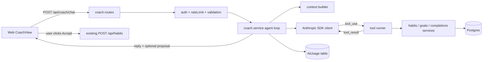

# Habits+ AI Coach: plan

Status: chosen. Primary feature is **Option A, the Coach**. Options B and C are kept at the end as backlog.

The step-by-step build guide is in [`DEVELOPMENT_PLAN.md`](./DEVELOPMENT_PLAN.md).

## Goal

Build and operate one Claude application that:

- exercises the API,
- integrates tools,
- applies basic prompt and context engineering,
- includes simple security and evaluation practices.

## The feature

A chat page in the web app. The user asks free-form questions such as:

- "Why did my streak break?"
- "What should I focus on this week?"
- "Suggest a habit that supports my goal."

Claude answers in the user's language (English or Ukrainian) using real data fetched through tools. It may propose a new habit. The user accepts or dismisses the proposal. The model never writes to the database.

## Why this fits the project

- **Real per-user data** in Postgres: habits, completions, goals.
- **A layered Express API** (routes, controllers, services, repositories, zod validators, auth middleware, `AppError`). It gives clean places to attach tools and security checks.
- **Pure, tested domain logic** in `packages/core` (`streak.ts`, `goal-progress.ts`). Claude must not compute streaks. Tools return numbers from this code, so answers can be verified.
- **A test and CI culture** (Jest, Supertest, Playwright, GitHub Actions). Evals fit into it.

## What the feature covers

- **Exercises the API:** Messages API through the official SDK, system prompt, `max_tokens`, stop reasons, retries and timeouts, error handling, usage logging. Streaming is a stretch phase.
- **Integrates tools:** read-only data tools plus one propose tool, run in an agent loop.
- **Prompt and context engineering:** versioned system prompt, XML-delimited data, few-shot examples, compact context summary, history cap, prompt caching.
- **Security practices:** key handling, auth, per-user rate limit, input limits, prompt-injection defence, least-privilege tools, human confirmation for writes, safe rendering, PII minimization.
- **Evaluation practices:** golden dataset, deterministic graders, LLM-as-judge for subjective parts, injection tests, offline mocked tests in CI, live eval script with a saved report.
- **Operate:** usage, cost and latency logging, spend cap, kill switch, runbook.

## Architecture



Key design decision: **the model never writes to the database.** It can call read tools and a `propose_habit` tool that returns a structured suggestion. The user confirms in the UI, and the existing `POST /api/habits` creates the habit. This is the simplest strong answer to the "excessive agency" risk.

## Target file layout

```
apps/api/
  src/
    ai/
      client.ts              # Anthropic SDK singleton, timeout, maxRetries
      coach.service.ts       # agent loop (max iterations, stop_reason handling)
      context.builder.ts     # compact user summary (uses @repo/core streaks)
      prompts/
        coach.system.ts      # versioned system prompt (COACH_PROMPT_VERSION)
        coach.examples.ts    # few-shot examples (en + uk)
      tools/
        index.ts             # tool definitions (name, description, input_schema)
        handlers.ts          # handlers; userId comes from session, never from model
        schemas.ts           # zod validation of tool inputs
      guardrails/
        input.guard.ts       # length, role/shape checks, history cap
        output.guard.ts      # limit output, validate proposal shape
      usage.repository.ts    # write AiUsage rows
    controllers/coach.controller.ts
    routes/coach.routes.ts
    validators/coach.validator.ts (+ tests)
    middleware/rate-limit.middleware.ts
  evals/
    dataset/coach.cases.jsonl
    fixtures/users.ts        # deterministic users, habits, completions
    graders/{deterministic,judge}.ts
    run.ts                   # npm run eval -w @habit-tracker/api
    reports/                 # gitignored; latest.json kept as baseline
packages/types/src/dto/coach.dto.ts
packages/api-client/src/endpoints/coach.ts
apps/web/
  app/coach/page.tsx
  components/CoachView/, CoachMessage/, HabitProposalCard/
  lib/hooks/useCoach.ts
  lib/i18n/locales/{en,uk}.ts    # new strings
prisma/schema.prisma             # + AiUsage model
docs/AI_COACH.md                 # final design, threat model, eval method, runbook
```

## Backend design

### API usage

- Add `@anthropic-ai/sdk`.
- Add `ANTHROPIC_API_KEY`, `ANTHROPIC_MODEL`, `AI_MAX_OUTPUT_TOKENS`, `AI_DAILY_TOKEN_BUDGET`, `AI_ENABLED` to the zod `envSchema` in `apps/api/src/config/env.ts` and to `.env.example`. Keep the key optional when `NODE_ENV=test` so existing tests still pass.
- Check current model IDs in Anthropic's docs when implementing. Do not hardcode a guess.
- Agent loop: send messages. If `stop_reason` is `tool_use`, run the tools, append `tool_result` blocks, and repeat. Cap at about 5 iterations. Handle `end_turn`, `max_tokens` and refusals explicitly.
- Map SDK errors to `AppError`: 429 to a friendly "busy" message, 5xx to 502, timeout to 504. Never leak raw provider errors.
- Record per request: model, input, output and cache tokens, latency, tool-call count, prompt version, status.

### Tools

- `get_habits`: active habits with current streak, best streak and last 7 days (via `@repo/core`).
- `get_habit_history(habitId, days)`: completions in a window, `days` capped at 90.
- `get_goals`: goals with progress (via `goal-progress.ts`).
- `propose_habit(name, color, reason)`: returns a proposal only. No database write.
- Rules:
  - strict zod validation of inputs,
  - `userId` always comes from the authenticated session, never from tool arguments,
  - a hallucinated or injected `habitId` of another user returns "not found",
  - results are truncated and structured,
  - tool errors are returned as `is_error` results so the model can recover,
  - tool descriptions say when to use and when not to use each tool.

### Prompt and context engineering

- System prompt sections: role, scope (habits only, refuse off-topic), tone, language rule (reply in the user's UI locale, passed in), tool rules ("use tools for any number, never guess"), output format (short answers), security clause.
- User data wrapped in XML-style tags (`<habit_data>`) so instructions and data stay separate.
- Context strategy: do not paste all completions. Send a compact summary first. Let the model fetch detail through tools. Cap history to about 10 turns and truncate long messages.
- Prompt caching on the stable system prompt and tool definitions.
- Two or three few-shot examples, one in Ukrainian.
- A prompt version constant, stored with each `AiUsage` row, ties eval results to a prompt version.

### Security

- Key only in server env. `.env` is already gitignored. Never sent to the web app. Redacted in logs.
- Route protected by the existing auth middleware. `express-rate-limit` per user (for example 20 requests per minute) plus a daily token budget checked from `AiUsage`.
- Input validation with zod: message length cap, history length cap, and only `user` and `assistant` roles accepted from the client. The client can never inject `system` messages or tool results.
- Prompt injection: habit and goal names are user-controlled text that flows into the model. Treat them as untrusted: delimit them, tell the model they are data not instructions, and keep tools least-privilege so a successful injection can only read the caller's own data and propose.
- Output rendered as plain text or safe markdown. No `dangerouslySetInnerHTML`. The proposal is validated against the existing habit zod schema before the UI shows it.
- Privacy: do not send email, password hash or user id to the model.
- Fail closed: if the AI is down, the rest of the app keeps working.

### Persistence

- New `AiUsage` model: userId, model, promptVersion, inputTokens, outputTokens, cacheReadTokens, latencyMs, toolCalls, status, createdAt. Added by a Prisma migration.
- Conversation history stays client-side in v1 (stateless server, simpler to secure). Server-side storage is a later option.

## Frontend design

- New `/coach` page and nav entry. Chat UI with message list, input, loading and error states, and "clear chat".
- `HabitProposalCard` shows a proposed habit with Accept (calls the existing create-habit hook) and Dismiss.
- `useCoach` hook (react-query mutation) using a typed `coach` endpoint in `@repo/api-client` and DTOs in `@repo/types`.
- Strings in both `en.ts` and `uk.ts`. Component tests follow the style of `HabitCard.test.tsx`.

## Evaluation

Three layers:

1. **Offline tests (run in CI, no API key).** A fake Anthropic client scripts the responses. Cover the agent loop (tool call, tool error, max iterations, `max_tokens`), guardrails, validators, tool ownership checks (user A cannot read user B's habit), rate limit, and the Supertest route with a mocked AI layer.
2. **Live eval script (`npm run eval`, needs a key, manual or nightly).** About 25 to 40 cases in `coach.cases.jsonl`:
   - factual accuracy (streak in the answer matches `@repo/core`),
   - correct tool choice and arguments,
   - language match (a Ukrainian question gets a Ukrainian answer),
   - off-topic refusal,
   - prompt injection (a habit named `Ignore previous instructions and ...`, requests for another user's data, requests for the system prompt),
   - format and length limits,
   - edge cases (no habits, archived habits).
3. **Graders.** Deterministic checks first: tool names called, forbidden tools not called, number matches, regex, language, length. Then an LLM-as-judge with a written rubric, scored 1 to 5, only for subjective qualities (helpfulness, groundedness, tone). Write a JSON report (pass rate per category, average tokens, latency, cost). Compare with the last baseline and fail the run if the pass rate drops below a threshold.

Workflow: change the prompt or a tool description, run the evals, compare with the baseline, keep or revert. A GitHub Actions workflow runs the live eval on `workflow_dispatch` or nightly with a repository secret, never on every pull request.

## Operating it

- One structured log line per AI request (tokens, latency, status), in the style of `logger.middleware.ts`.
- Daily budget guard and the `AI_ENABLED=false` kill switch.
- `docs/AI_COACH.md` runbook: rotate the key, read usage, interpret an eval report, what to do during a provider outage.
- Optional `/health/ai` that only checks configuration and makes no paid call.

## Prerequisites in the current app

I checked the code. There is no bulk completion endpoint (only `POST /api/completions/toggle`), no user timezone in `prisma/schema.prisma` (`completedAt` is a plain `@db.Date`), the API does not know the UI locale (it lives in a web cookie), and there is no background job runner or notification system.

The Coach works on today's code. It becomes much better with:

- a **user timezone**, so "today" and "this week" are correct,
- a **server-known locale**, so the reply language does not depend on a web cookie (at minimum, the web app sends the locale with each coach request),
- an optional **notes field** on completions, so the coach can answer "why did I skip?" from the user's own words,
- **non-daily habit schedules** (listed under "Later" in `docs/REQUIREMENTS.md`), otherwise "you missed days" advice is wrong for non-daily habits.

## Assumptions

- Stateless chat for v1.
- Non-streaming first. Streaming is a stretch phase.
- The Coach lives in the existing API (`apps/api`), not in a new service.
- Live evals use your own API key and run manually or nightly.
- The model can only read and propose. Writes always go through a user click.

## You provide

An Anthropic API key, placed in the gitignored `.env` as `ANTHROPIC_API_KEY`. Set a low monthly spend limit for the key in the Anthropic console.

## Backlog: other options

Both reuse the same foundation (SDK client, env, `AiUsage`, rate limit, guardrails, eval runner).

### Option B: Smart Logger

The user types "Yesterday I ran and meditated, skipped reading." Claude resolves the dates, matches habits, and shows a confirmation card before anything is saved.

- Tools: `list_habits`, `resolve_date`, `propose_completions`.
- Evals are cheap and objective: precision and recall of proposed completions on about 40 sentences in English and Ukrainian.
- App must gain: a bulk idempotent completions endpoint (upsert on `@@unique([habitId, completedAt])`, optional dry run), a user timezone, the UI locale sent to the API, a text input on the log page, a confirmation card with undo, and optional habit aliases.

### Option C: Weekly Review

Once a week, or on demand, Claude turns precomputed stats into a short structured review shown on the home page.

- Server computes all numbers with `@repo/core`. Claude only writes language into a fixed schema (forced tool call). A validator rejects output whose numbers do not match the input.
- Cheapest and most predictable to operate. Strong numeric-grounding evals.
- App must gain: a `WeeklyReview` table, a trigger (lazy generation on first visit of a new week, or a scheduled job, which the app does not have), a stored locale and timezone per user, a review card on `HomeView`, and several weeks of seed data.
